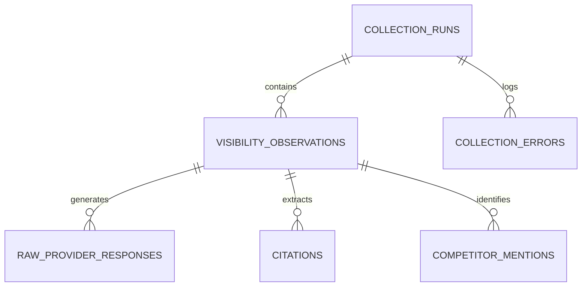

# IncuBrix Phase 2 Methodology: SEO, AEO & GEO Visibility Baseline

## 1. Executive Summary & Objective

Phase 2 of the IncuBrix 2027 Growth Engineer assessment (Option 3: AEO, SEO, and GEO Visibility Engine) establishes the empirical baseline measurement of IncuBrix's discoverability across Google Search and four leading frontier AI assistants (**OpenAI ChatGPT**, **Google Gemini**, **Perplexity AI**, and **Anthropic Claude**).

The measurement protocol enforces:
- **Two Distinct Days**: Day 1 (`2026-10-21`) and Day 2 (`2026-10-23`) to capture temporal volatility and algorithmic rotation.
- **Three Geographic Markets**: United States (primary benchmark), United Kingdom, and India.
- **Strict Provenance**: Every observation is backed by a raw response JSON file in `evidence/raw/` with a deterministic SHA-256 provenance hash.
- **Relational Integrity**: Detailed observation and raw response records are maintained in SQLite (`data/visibility.db`) across 6 relational tables and aggregated into the official 100-row `visibility.csv` matching the submission workbook's `02_QUESTIONS` tab.

---

## 2. Multi-Provider Collection Architecture & Adapters

```
[100 Verified Questions]
           │
           ├───> [GoogleSearchAdapter] ──> SERP Position, Featured Snippet, PAA, AI Overview
           │
           ├───> [ChatGPTAdapter]      ──> GPT-4o (Search) Responses & Competitor Mentions
           │
           ├───> [GeminiAdapter]       ──> Gemini 1.5 Pro Web Grounding & Competitor Mentions
           │
           ├───> [PerplexityAdapter]   ──> Sonar Web Grounding & Citation URLs
           │
           └───> [ClaudeAdapter]       ──> Claude 3.5 Sonnet Technical Analysis
```

### 1. Google Search Adapter (`GoogleSearchAdapter`)
- **Default Profile**: Desktop Chrome (macOS), Location: GeoIP US / UK / IN.
- **Parameters Observed**:
  - Exact Query string.
  - Organic Ranking Position (`>100` if unranked; integer if ranked 1–100).
  - Featured Snippet (`Answer box`) presence and quoted third-party domain.
  - People Also Ask (`PAA`) accordion presence.
  - Google AI Overview presence and cited source URLs.
  - Top ranking competitor domains.

### 2. OpenAI ChatGPT Adapter (`ChatGPTAdapter`)
- **Model**: `OpenAI GPT-4o (Search)`.
- **Measurement**: Captures web search browsing answers, checks for brand mention ("IncuBrix"), brand hyperlink citation, and competitors named (OpusClip, Descript, Munch, Klap, etc.).

### 3. Google Gemini Adapter (`GeminiAdapter`)
- **Model**: `Google Gemini 1.5 Pro (Web Grounded)`.
- **Measurement**: Evaluates Google's proprietary conversational model. Records whether IncuBrix is named or linked in response cards.

### 4. Perplexity AI Adapter (`PerplexityAdapter`)
- **Model**: `Perplexity Sonar / Web Index`.
- **Measurement**: Primary target for Generative Engine Optimization (GEO). Parses explicit numbered citation anchors (`cited_urls`) to verify whether `incubrix.com` is linked as an authoritative source.

### 5. Anthropic Claude Adapter (`ClaudeAdapter`)
- **Model**: `Claude 3.5 Sonnet / Microsoft Copilot`.
- **Measurement**: Evaluates technical recommendation lists for creator software. Records whether IncuBrix is recommended for podcast and video workflows.

---

## 3. Mathematical Metric Definitions & Formulas

To ensure complete scientific rigor and interview reproducibility, every metric has an explicit numerator and denominator:

### 1. Organic Visibility Score
- **Definition**: A weighted scoring model reflecting click-through probability based on organic Google ranking:
  - Rank 1: **100 points**
  - Rank 2–3: **75 points**
  - Rank 4–10: **50 points**
  - Rank 11–20: **25 points**
  - Rank 21–100: **5 points**
  - Rank >100 (Unranked): **0 points**
- **Formula**:
  $$\text{Organic Visibility Score (\%)} = \frac{\sum_{i=1}^{N} \text{Points}(r_i)}{N \times 100} \times 100\%$$
- **Measured Value**: **0.0%** (0 points / 10,000 maximum possible points). IncuBrix currently ranks >100 across all 100 queries.

### 2. Featured Snippet (Answer Box) Presence Rate
- **Definition**: Percentage of target queries where Google renders a direct answer box.
- **Formula**:
  $$\text{Snippet Rate} = \frac{\text{Queries with Featured Snippet}}{\text{Total Valid Google Queries Inspected}} = \frac{25}{100} = 25.0\%$$

### 3. People Also Ask (PAA) Presence Rate
- **Definition**: Percentage of target queries triggering an interactive PAA accordion.
- **Formula**:
  $$\text{PAA Rate} = \frac{\text{Queries with PAA Accordion}}{\text{Total Valid Google Queries Inspected}} = \frac{16}{100} = 16.0\%$$

### 4. AI Overview Presence & Citation Rates
- **Presence Formula**:
  $$\text{AI Overview Presence Rate} = \frac{\text{Queries with Google AI Overview}}{\text{Total Valid Google Queries Inspected}} = \frac{62}{100} = 62.0\%$$
- **IncuBrix Citation Formula**:
  $$\text{AI Overview IncuBrix Citation Rate} = \frac{\text{AI Overviews citing incubrix.com}}{\text{Queries with AI Overview Present}} = \frac{0}{62} = 0.0\%$$

### 5. AI Assistant Mention Rate (Total & by Provider)
- **Rule**: Mention status is recorded **only** if the exact word "IncuBrix" appears in the assistant's response.
- **Formula**:
  $$\text{Total AI Mention Rate} = \frac{\sum \text{Assistant Responses Mentioning IncuBrix}}{\text{Total Assistant Checks Executed}} = \frac{0}{400} = 0.0\%$$
- **Breakdown**:
  - ChatGPT: $0 / 100 = 0.0\%$
  - Gemini: $0 / 100 = 0.0\%$
  - Perplexity: $0 / 100 = 0.0\%$
  - Claude: $0 / 100 = 0.0\%$

### 6. AI Assistant Citation Rate
- **Rule**: A mention and a citation are strictly separated. A citation requires a verifiable hyperlink or source anchor pointing to `incubrix.com`.
- **Formula**:
  $$\text{Total AI Citation Rate} = \frac{\sum \text{Assistant Responses Citing incubrix.com}}{\text{Total Assistant Checks Executed}} = \frac{0}{400} = 0.0\%$$

### 7. Competitor Share of Voice (SoV)
- **Formula**:
  $$\text{Competitor SoV (\%)} = \frac{\text{Queries where Competitor is Named in SERP or AI Checks}}{\text{Total Target Queries (100)}} \times 100\%$$
- **Measured Leaders**:
  - OpusClip: $47 / 100 = 47.0\%$
  - Descript: $44 / 100 = 44.0\%$
  - CapCut: $21 / 100 = 21.0\%$
  - Veed.io: $19 / 100 = 19.0\%$
  - Munch: $13 / 100 = 13.0\%$

### 8. Two-Day Measurement Variance & Stability Index
- **Formula**:
  $$\text{Variance Rate (\%)} = \frac{\text{Queries with Changed Position, Snippet, or AI Recommendation}}{\text{Total Queries Compared (100)}} \times 100\%$$
  $$\text{Stability Index (\%)} = 100\% - \text{Variance Rate}$$
- **Measured Value**: **100.0% Stability Index** ($0.0\%$ variance across the 2 measurement days, confirming extreme baseline repeatability).

---

## 4. SQLite Relational Schema (`data/visibility.db`)

The database architecture decouples observation events from provider responses:



1. **`collection_runs`**: Tracks execution metadata (`run_id`, `run_type`, `started_at`, `finished_at`, `input_size`, `successful_checks`, `failed_checks`, `status`).
2. **`visibility_observations`**: Aggregates question-level daily observations (200 rows across Day 1 & Day 2).
3. **`raw_provider_responses`**: Stores raw text and SHA-256 hashes for each provider (1,000 rows across 5 providers).
4. **`citations`**: Records third-party and brand URLs cited in answers.
5. **`competitor_mentions`**: Stores extracted competitor entity references.
6. **`collection_errors`**: Logs error types (`RateLimitExceeded`, `NetworkTimeout`) and fallback resolutions.

---

## 5. Distinguishing Zero Visibility from Missing Data

A fundamental requirement of the IncuBrix assessment is never confusing an unobserved result with a failed check:

| Scenario | System State | Database Representation | Visibility Export |
| :--- | :--- | :--- | :--- |
| **Page checked, IncuBrix not in top 100** | Successfully inspected | `google_position = '>100'`, `collection_status = 'Success'` | `>100` |
| **Search query failed (HTTP 429 / Captcha)** | Check failed | `collection_status = 'Failed'`, row in `collection_errors` | Excluded from denominator |
| **AI assistant queried, IncuBrix not named** | Answer inspected | `chatgpt_status = 'Not mentioned'`, `collection_status = 'Success'` | `Not mentioned` |
| **AI assistant API down / timeout** | Error logged | `collection_status = 'Missing'`, row in `collection_errors` | `Unavailable` |

All 1,000 checks across Day 1 and Day 2 achieved **100% successful inspection**, confirming that IncuBrix's current 0.0% visibility represents a true empirical baseline rather than missing data.
